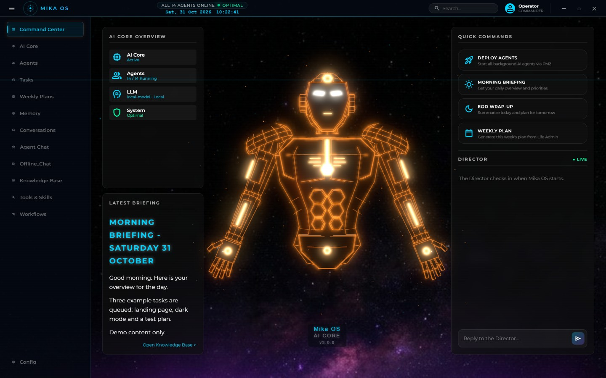
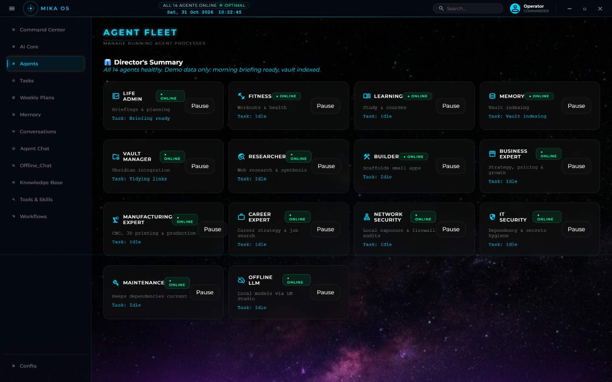
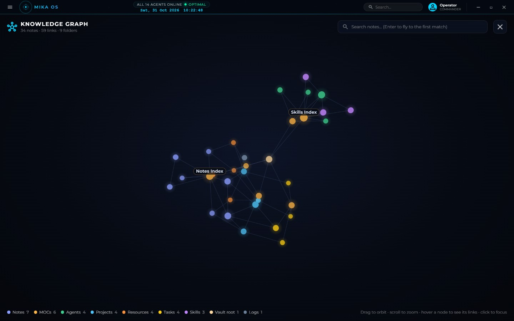
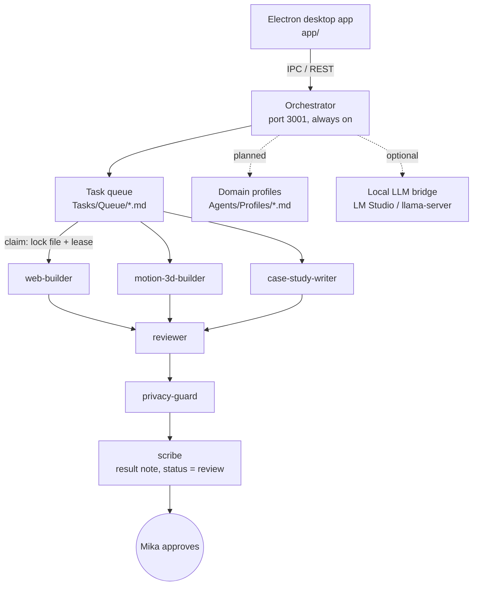

# Mika OS

**A personal AI operations system where one orchestrator hands work to short-lived role agents, and a markdown vault is the single source of truth.**

I built it to stop babysitting a pile of always-on bots. It started as 15 background services. It is turning into one small orchestrator plus specialists that wake up, do one task, write down what they did, and leave. Its old name, CHAMP OS, survives in a few folder names.

> Status, honestly: the desktop app and the original agent fleet work. The task-queue helpers (claim, heartbeat, finish, stale takeover) are written and tested but not wired into the orchestrator yet. The migration is in steps, and the unfinished ones are marked below.

## What it looks like

| Command Center | Agent fleet | Knowledge graph |
|---|---|---|
|  |  |  |

These are taken from this repo's app running against a small fictional demo vault, with a stub serving demo agent statuses. My real vault stays private. More of my work lives in my portfolio: [mikachamp.github.io/portfolio](https://mikachamp.github.io/portfolio/).

## The 30-second version

- **One orchestrator** routes requests and (soon) dispatches queued tasks.
- **Role sub-agents** (web-builder, reviewer, privacy-guard, scribe, and more) are launched per task with a fixed reading list, limits and test standard.
- **Domain "agents" are being turned into markdown profile notes.** Fitness, learning, business, manufacturing, career and life-admin are the six. Phase 1 is done: the notes exist. The orchestrator doesn't read them yet; Phase 2, behind a `USE_LOCAL_PROFILES` flag, is planned.
- **An Obsidian vault is the control centre.** Tasks are files, results are files, locks are files. Humans and agents read and write the same thing.
- **An Electron desktop app** sits on top: frameless window, tray icon, chat, agent status.
- **Humans approve.** Agents stop at `review`. They never publish, push, send, delete or spend.

## Architecture



Two layers, kept apart on purpose: the Electron UI (`app/`) and the agent engine (`agents/`). I can reload or redesign the UI without killing a long-running job.

## From 15 daemons to one orchestrator (the ADR)

The first version was a PM2 fleet on ports 3001 to 3015: an orchestrator, life-admin, fitness, learning, memory, vault-manager, researcher, builder, three consultative experts, network-security, it-security, maintenance, and an offline-LLM bridge.

It worked, and it taught me what was wrong with it. The architecture decision record lists five problems:

1. **RAM.** Idle Node processes cost an estimated 1.2 to 2.0 GB while I was doing CAD or slicing.
2. **One GPU.** Local inference runs on a single laptop GPU. Many agents asking at once meant queue timeouts and model thrashing.
3. **Thin wrappers.** Five of the "agents" were the same Express server around one hard-coded system prompt.
4. **A chatty director loop** re-evaluating unchanged status files every 20 to 30 seconds.
5. **Rigid dispatch.** I wanted three website tasks side by side, not one static "builder".

The new shape: keep the orchestrator, turn wrappers into profile notes, turn audits and briefings into run-and-exit jobs, turn the builder into role sub-agents. Full write-up: [docs/BUILD-STORY.md](docs/BUILD-STORY.md).

## The task queue (files, locks, leases)

Every task is one markdown file with YAML frontmatter: `id`, `role`, `assignee`, `status`, `depends_on`, `touches`, `done_test`, `claimed_by`, `lease_until`.

- **Claim = create a lock file** with exclusive create (`fs.open(path, 'wx')`). If it exists, someone else has the task. No database, no race.
- **Lease.** A claim sets `lease_until` 30 minutes ahead; a heartbeat extends it.
- **Stale takeover.** Only the orchestrator may reclaim a task whose lease expired more than 10 minutes ago, and it logs one line when it does.
- **`touches` is a fence.** Two tasks whose `touches` overlap never run together.
- **Cap.** At most 3 tasks in `working` at once. More agents just create a review queue.
- **Finish.** `finishTask` writes the result link, sets `review`, and moves the lock to `locks/released/` (never deletes it).

The helpers are `claimTask`, `heartbeat`, `finishTask`, `releaseLock`, `takeOverStaleTask` in `agents/shared/obsidian.js`, with 18 tests in `agents/shared/test/obsidian-tasks.test.js` (all passing at the time of writing).

## The pipeline and the human gates

```
explorer -> builder role -> reviewer -> privacy-guard -> scribe -> design-librarian
```

A failed review goes back to the builder, not to me. Anything others will see goes through privacy-guard. I am the only one who can set a task to `done`. Agents never publish, push, commit, send, delete, spend, or submit forms. They also have to cite files for facts and are told never to invent numbers, clients or dates. The full rules are in [AGENT_OPERATING_RULES.md](AGENT_OPERATING_RULES.md).

## How I test (and why it matters)

I do not take "it works" on trust, from a model or from me.

- Headless Chrome through `puppeteer-core`, at **1440x900** and **390x844**.
- No console errors, and `scrollWidth - innerWidth == 0` (no sideways scroll).
- Builds must open from `file://` and offline.
- Reduced motion is emulated and checked.
- For WebGL timing: the **real GPU** (`--use-angle=d3d11`). Software rendering gives meaningless frame rates.
- Backend code: `node --check`, an import check, and `node --test`, with tests running in a temp vault so the real one is never touched.

## What broke, and how I fixed it

- **Claim helper ate fields.** A regex using `\s*` matched the newline, so claiming a task on a fresh file deleted the next frontmatter line. A review found 10 bugs in those helpers; they were rewritten and tested (see the build story).
- **Case studies with wrong facts.** A reviewer caught a wrong Electron version, an overstated "immutable history", and, on another write-up, claims with no source file. Every claim now has to cite one.
- **"14 agents".** The ADR said 14 in the heading and had 15 rows in the table. The reviewer counted.
- **A leaking agent.** One agent's memory use ran away (host RAM at 99%). Restarting it dropped the host to 78%. That is one reason the always-on model is going.
- **Hidden overflow.** A page looked fine at 390 px because overflow was hidden, not fixed. Review caught it; my rule is now "fixed or visibly handled".

## What lives where

| Folder | What it is |
|---|---|
| `app/` | The Electron desktop app (frameless window, tray, chat, graph views) |
| `agents/` | Orchestrator, PM2 config, the agent services, shared libraries (`shared/obsidian.js`, `shared/llm.js`) |
| `agents/shared/subagent-roles.json` | The role registry: does, reading list, test standard, limits |
| `.claude/agents/` | One agent file per role, generated from the registry |
| `AGENT_OPERATING_RULES.md` | The rules every agent follows |
| `docs/` | The build story |

## Run it

```bash
# run the queue-helper tests (18 tests)
cd agents && npm install && node --test shared/test/obsidian-tasks.test.js

# start the desktop app
cd app && npm install && npm start
```

Local models are optional (LM Studio on `localhost:1234` or a bundled `llama-server`). To start the agent fleet, run `npx pm2 start ecosystem.config.cjs` inside `agents/`.

## Honest boundaries

Personal desktop tool. No login, no multi-user backend, no custom-trained models; it orchestrates open-weight and cloud models. When the local model is down, the shared LLM helper can fall back to a cloud model, so "fully offline" only holds if you stay on the local path.

Companion repos: [mika-os-knowledge-base](https://github.com/mikachamp/mika-os-knowledge-base) (the vault template), [web-lab](https://github.com/mikachamp/web-lab).
